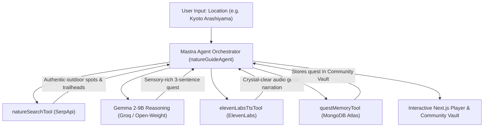

*This is a submission for the [Hacktoberfest Open-Source AI Challenge Week 1: Touch Grass](https://dev.to/challenges/hacktoberfest-week1-2026-10-05)*

---

## 🌟 What I Built

**NatureQuest Audio Explorer** is an open-source agentic web application engineered to solve digital screen fatigue. In a world of notifications and doomscrolling, NatureQuest gently nudges you to close your laptop, lace up your shoes, and literally **touch grass**.

Enter any city, neighborhood, or park, and NatureQuest orchestrates an autonomous AI agent that:
1. **Scouts real trails & parks** near you using **SerpApi**.
2. **Crafts an inspiring 3-sentence sensory quest** using the open-weight **Gemma 2-9B** model.
3. **Synthesizes a calming audio companion** via **ElevenLabs**, complete with timeline scrubbers, volume controls, and offline download support.
4. **Preserves the quest into a global Community Vault** powered by **MongoDB Atlas**.

---

## 🚀 Demo & Code

- **Live Web App on Render:** `https://naturequest-audio-explorer.onrender.com`
- **GitHub Repository:** [github.com/farhanmallik05/naturequest-audio-explorer](https://github.com/farhanmallik05/naturequest-audio-explorer)

---

## 🏗️ How I Built It: The Agentic Workflow

Instead of a monolithic prompt, NatureQuest implements an autonomous agent architecture powered by **Mastra**:



```
[ User: "Kyoto Arashiyama" ]
            │
            ▼
┌────────────────────────────────────────────────────────┐
│            Mastra Agent Orchestration Loop             │
├────────────────────────────────────────────────────────┤
│ 1. natureSearchTool (SerpApi)                          │
│    Scouts authentic outdoor spots and trailheads       │
│                                                        │
│ 2. Gemma 2-9B Reasoning (Groq / Open-Weight)           │
│    Crafts sensory-rich 3-sentence quest                │
│                                                        │
│ 3. elevenLabsTtsTool (ElevenLabs)                      │
│    Generates crystal-clear audio guide                 │
│                                                        │
│ 4. questMemoryTool (MongoDB Atlas)                     │
│    Stores quest into global community vault            │
└────────────────────────────────────────────────────────┘
            │
            ▼
[ Interactive Next.js Player + Community Adventure Vault ]
```

### 1. Agent & Tools Orchestration (Mastra)
We instantiated a genuine Mastra `Agent` (`natureGuideAgent` via `@mastra/core/agent`) coupled with modular tools via `@mastra/core/tools` (`natureSearchTool`, `elevenLabsTtsTool`, `questMemoryTool`). The orchestrator coordinates tool calls, validates inputs and outputs with Zod schemas, and handles graceful error boundaries.

### 2. Open-Weight Model Reasoning (Gemma via Groq)
We prompt **Gemma 2-9B-IT** using an intentional sensory framework:
- *Sentence 1 (Invitation):* Direct call to step away from screens and visit a named trailhead.
- *Sentence 2 (Mindful Action):* An actionable sensory cue (e.g. feeling cool pine bark, smelling damp soil, noticing wind patterns).
- *Sentence 3 (Perspective):* A philosophical closing on how nature reconnects our mind.

### 3. Voice Companion & Clean Audio Streaming (ElevenLabs & Next.js)
Walking outside shouldn't mean staring down at your smartphone. NatureQuest converts the written quest into a soothing spoken narration using ElevenLabs Rachel voice. We designed a dual audio architecture: immediate base64 playback for newly synthesized adventures, plus a dedicated clean binary MP3 audio endpoint (`GET /api/quest?id=...&audio=1`) that delivers proper `audio/mpeg` streaming headers and HTTP caching without bloating JSON payloads. The frontend features a custom audio player with timeline seeking, waveform visualization, and an offline `.mp3` download button so hikers can continue their quest even when cell reception drops.

### 4. Persistent Memory Layer (MongoDB Atlas)
Every quest is logged into MongoDB Atlas, creating a collective community vault of nature quests worldwide. Hikers can browse past quests, replay audio guides, and see what green spaces other explorers discovered.

### 5. Deployment & Reliability (Render & Sentry)
- **Render Web Service:** Built with declarative infrastructure via `render.yaml` and a multi-stage `Dockerfile`.
- **API Guardrails:** In-memory sliding-window rate limiter (15 requests/min per IP) to prevent DDoS and API quota exhaustion.
- **Sentry Integration:** Real-time exception capture for front-end and back-end runtimes.

---

## 🌍 Why Open Innovation Matters

Open innovation and open-weight models like **Gemma** are foundational to the future of technology:

1. **True Offline Freedom in the Backcountry:** Closed proprietary APIs require high-speed internet. When you hike into deep ravines or mountain trails where cell towers can't reach, closed models are useless. Because Gemma is open-weight, it can run locally on an edge device (e.g., using Ollama or llama.cpp on a phone or Raspberry Pi in a backpack), providing guidance anywhere on Earth.
2. **No Monopolistic Vendor Lock-in:** Open models ensure developers aren't vulnerable to unexpected price hikes, sudden deprecations, or opaque content filtering on benign outdoor descriptions.
3. **Auditable & Fine-Tunable:** Communities can adapt Gemma to regional ecology, indigenous botanical knowledge, and localized conservation efforts without asking permission from big-tech gatekeepers.

---

## 🏆 Prize Categories

- **Best Use of Mastra:** Modular `createTool` architecture, typed inputs/outputs, and autonomous tool orchestration.
- **Best Use of Gemma:** Core generative intelligence powered by Google's Gemma 2-9B model.
- **Best Use of ElevenLabs:** High-fidelity voice synthesis designed specifically for screen-free walking experiences.
- **Best Use of SerpApi:** Live localized search discovering actual green spaces and parks.
- **Best Use of MongoDB Atlas:** Scalable cloud document storage providing persistent adventure history.
- **Best Use of Render:** Automated deployment pipeline via `render.yaml` infrastructure-as-code.

---

## 💚 Final Thought

Next time you feel overwhelmed by browser tabs or Slack notifications, remember: the outdoors is only a few steps away. Go outside, breathe deeply, and touch grass!
